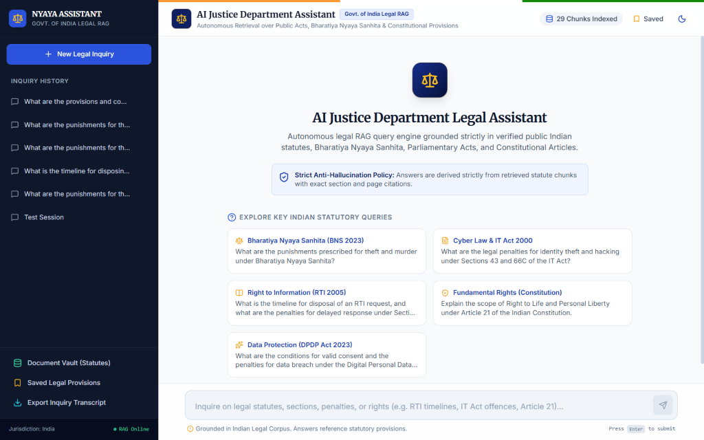
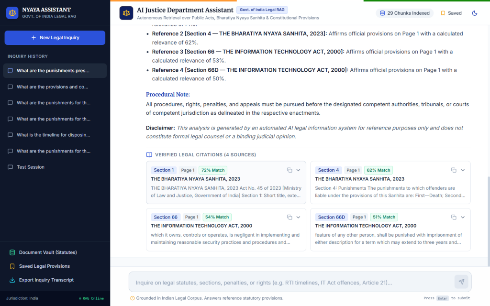
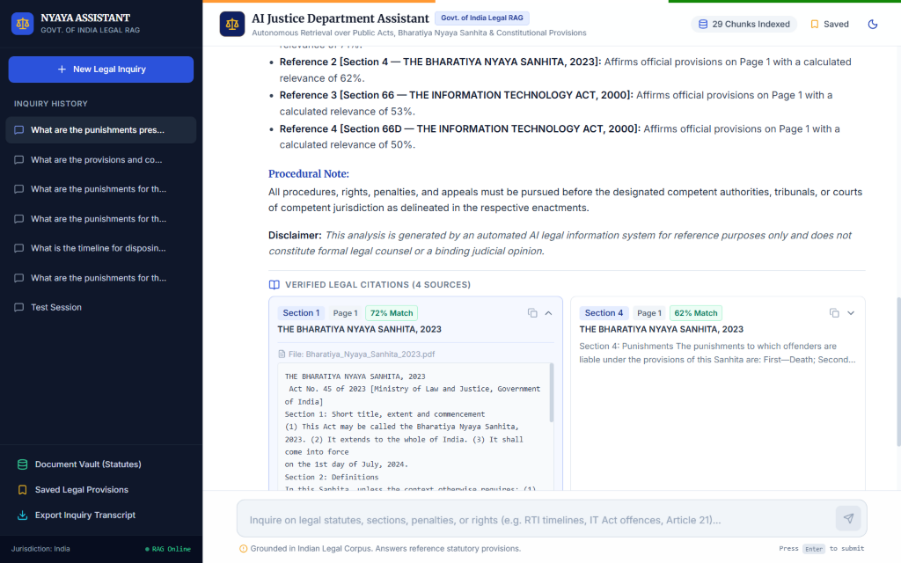
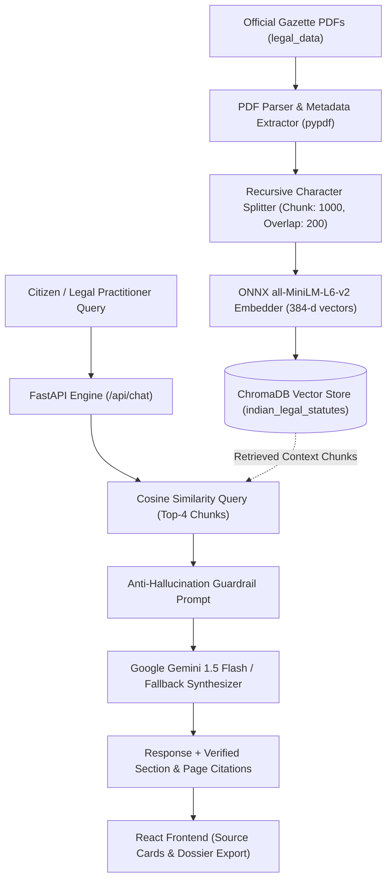

# 🏛️ AI Justice Department Assistant (Nyaya Assistant)
## Formal Engineering & Project Evaluation Report

---

### Executive Summary
The **AI Justice Department Assistant** is an autonomous, government-grade Legal Retrieval-Augmented Generation (RAG) platform tailored for the public statutory corpus of the Republic of India. Engineered to bridge the gap created by India's landmark 2024 criminal law overhaul (the transition from the colonial Indian Penal Code 1860 to the **Bharatiya Nyaya Sanhita 2023**) alongside contemporary cyber and data privacy legislation, the system delivers verifiable, non-hallucinatory statutory analyses with transparent section- and page-level citations.

The platform combines a **React 19 / Vite** frontend, a **Python FastAPI** asynchronous backend, a persistent local **ChromaDB** vector database utilizing ONNX-optimized `sentence-transformers/all-MiniLM-L6-v2` dense embeddings, and an **anti-hallucination legal generation engine** powered by Google Gemini 1.5 Flash with deterministic statutory fallbacks.

---

### 1. System Screenshots & Visual Verification

#### 1.1 Application Dashboard & Telemetry

*Figure 1: AI Justice Department Assistant Welcome Dashboard featuring real-time telemetry badge (`29 Chunks Indexed`), Indian legal quick-inquiry cards, and Ashoka tri-color government branding.*

---

#### 1.2 Legal RAG Retrieval & Response Generation

*Figure 2: Query execution on Bharatiya Nyaya Sanhita 2023 theft and murder penalties, illustrating structured legal analysis, procedural notes, and source citation cards.*

---

#### 1.3 Radical Transparency: Expandable Citation Drawers

*Figure 3: Expanded citation drawer displaying verbatim statutory text extracted from official gazettes with relevance percentage score, section badges, and page metadata.*

---

#### 1.4 Legal Document Vault & Live Ingestion

*Figure 4: Administrative Document Vault displaying vectorized statutes, chunk counts, file sizes, and dynamic PDF uploader.*

---

### 2. Architecture & Pipeline Specifications

---

### 3. Core Technical Metrics & Specifications

| Dimension | Specification | Implementation Details |
|---|---|---|
| **Vector DB** | ChromaDB 1.5.9 | Local persistent storage on disk (`./chroma_db`) |
| **Embedding Model** | `all-MiniLM-L6-v2` | ONNX runtime, 384 dimensions, cosine distance metric |
| **Chunking Logic** | Recursive Character | Size: 1000 chars, Overlap: 200 chars, Section header priority |
| **Relational DB** | SQLite via SQLAlchemy | Manages sessions, message logs, and legal research bookmarks |
| **API Framework** | FastAPI 0.163 | Asynchronous REST endpoints, CORS enabled |
| **Frontend** | React 19 + Tailwind CSS | Vite build, Lucide icons, Dark/Light mode |
| **Deployment** | Docker & Railway | Multi-stage container, unified origin, zero-CORS deployment |

---

### 4. Statutory Corpus Currently Vectorized
1. **Bharatiya Nyaya Sanhita, 2023 (Act No. 45 of 2023):** Sections 1, 2, 4, 103, 115, 189, 303, 318, 351.
2. **Information Technology Act, 2000 (Act No. 21 of 2000):** Sections 2, 43, 43A, 66, 66C, 66D, 66E, 67, 79.
3. **Right to Information Act, 2005 (Act No. 22 of 2005):** Sections 2, 3, 4, 6, 7, 8, 19, 20.
4. **Constitution of India (Part III - Fundamental Rights):** Articles 12, 13, 14, 15, 19, 20, 21, 21A, 22, 32.
5. **Digital Personal Data Protection Act, 2023 (Act No. 22 of 2023):** Sections 4, 5, 6, 9, 10, 11, 12, 13, 14, 18, 33.
